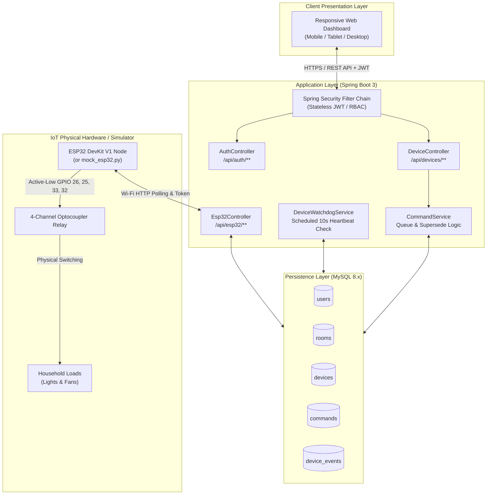
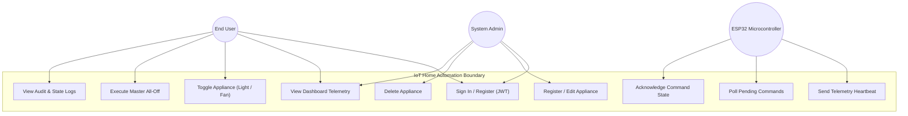
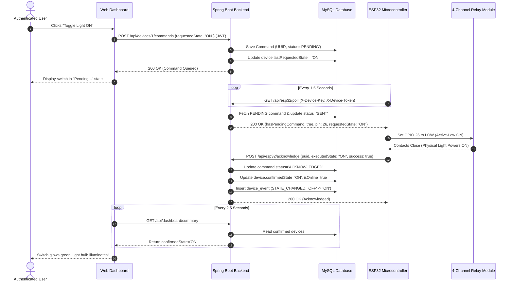
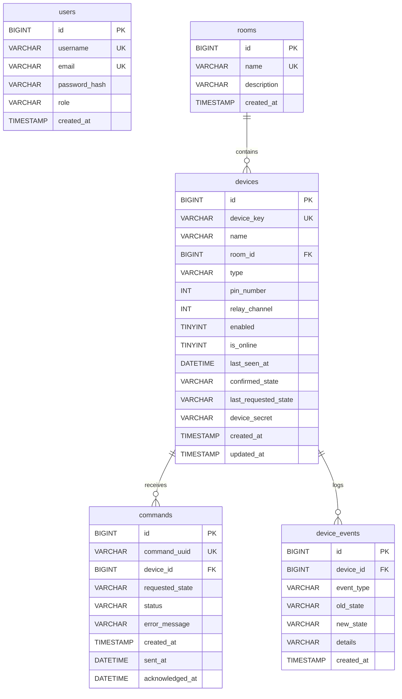
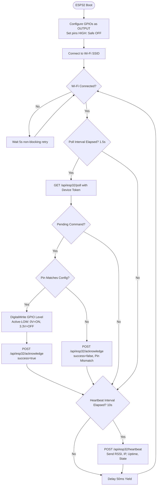

# Major College Project Report
# IoT-Based Home Automation System using ESP32

---

## Academic Project Details
- **Project Title**: IoT-Based Home Automation System using ESP32
- **Technologies Used**: ESP32 WROOM-32, C++ Arduino Core, Java 25, Spring Boot 3.3.x, Spring Data JPA, Spring Security, MySQL 8.x, Bootstrap 5, HTML5/CSS3/JavaScript
- **Domain**: Internet of Things (IoT), Full-Stack Enterprise Web Engineering, Embedded Systems

---

## 1. Abstract

The advent of the Internet of Things (IoT) has transformed domestic environments by enabling remote automation, energy optimization, and real-time appliance monitoring. This project presents a complete, production-grade **IoT-Based Home Automation System using ESP32**, a high-performance Java Spring Boot backend, and a normalized MySQL relational database.

Unlike conventional hobbyist tutorials that assume clicking a button immediately alters the physical state, this system implements an enterprise-grade command lifecycle with guaranteed acknowledgements, cryptographic device token authentication, non-blocking Wi-Fi reconnect routines, and an automated background watchdog that monitors hardware liveness. Users can remotely control household lights and fans from mobile, tablet, or desktop browsers. The physical ESP32 node continuously executes authenticated polling, actuates optically isolated relays with fail-safe boot policies, and reports verified physical telemetry. An integrated Python-based hardware digital twin allows comprehensive software testing before hardware deployment.

---

## 2. Problem Statement & Objectives

### 2.1 Problem Statement
Traditional home automation setups suffer from significant flaws:
1. **Unreliable State Reporting**: Most basic solutions assume frontend button toggles reflect physical appliance status without verifying real hardware actuation.
2. **Insecure Microcontroller Endpoints**: IoT nodes frequently communicate using unauthenticated HTTP endpoints or hardcoded shared credentials.
3. **Hardware Hazards**: Careless remote GPIO pin assignment can reconfigure microcontroller boot-strapping pins or flash memory lines, destroying or bricking the microcontroller.
4. **Lack of Fault Recovery**: When network drops or brownouts occur, systems enter deadlock without automated retry or offline recovery strategies.

### 2.2 Project Objectives
- Develop an authenticated RESTful backend using Java 25 and Spring Boot 3.x.
- Design a normalized MySQL 8.x schema to track devices, rooms, users, commands, and audit logs.
- Implement an authenticated ESP32 firmware sketch featuring non-blocking Wi-Fi reconnect and active-low relay logic.
- Enforce strict GPIO whitelisting to eliminate hardware malfunction risks.
- Design a responsive, glassmorphic web dashboard with real-time telemetry, fan animations, and master All-Off safety controls.
- Provide a Python hardware simulator for continuous automated testing.

---

## 3. Existing System vs. Proposed System

| Parameter | Existing Hobbyist Systems | Proposed Enterprise IoT System |
|---|---|---|
| **Microcontroller Communication** | Unauthenticated plaintext HTTP or open brokers | Cryptographically authenticated via `X-Device-Token` |
| **State Verification** | Optimistic (assumes click = physical change) | Pessimistic / Verified: Distinguishes requested vs confirmed state |
| **Microcontroller Safety** | Arbitrary GPIO assignment allowed remotely | Strict software whitelist of verified safe output GPIOs |
| **Relay Logic Handling** | Hardcoded logic often causing boot spikes | Active-Low optocoupler driving with safe boot (All OFF) |
| **Offline Handling** | Infinite loading spinners; silent failures | Watchdog timer detects missed heartbeats (>35s) & alerts UI |
| **Database Architecture** | Flat files or non-relational collections | Normalized 3NF MySQL relational schema with foreign key integrity |
| **Security & Auth** | Shared passwords or open routes | Role-Based Access Control (RBAC) with BCrypt & Stateless JWT |

---

## 4. Feasibility Study

1. **Technical Feasibility**:
   - The ESP32 DevKit V1 integrates dual-core processing with built-in Wi-Fi, rendering external network shields unnecessary.
   - Java Spring Boot provides mature connection pooling (HikariCP), JPA ORM, and robust security filters capable of handling hundreds of concurrent poll requests.
2. **Economic Feasibility**:
   - Total hardware bill of materials is under \$15 - \$20 USD (ESP32, 4-channel relay module, 5V power supply, jumper wires).
   - Software stack relies entirely on open-source, enterprise-grade tooling (Java OpenJDK, Apache Maven, MySQL Community Server, Bootstrap).
3. **Operational Feasibility**:
   - Accessible via any web browser without native application installation.
   - Intuitive toggle switches, color-coded status badges, and one-click All-Off safety confirmation.

---

## 5. Software & Hardware Requirements Specification (SRS)

### 5.1 Hardware Requirements
- **Microcontroller**: ESP32 DevKit V1 (ESP-WROOM-32, 30-pin)
- **Actuator Module**: 4-Channel 5V Optocoupler Isolated Relay Board (Songle SRD-05VDC-SL-C)
- **Power Unit**: 5V 2A DC regulated USB power adapter
- **Demonstration Loads**: 5V/12V DC LEDs and DC brushless cooling fans
- **Interconnects**: 20cm Male-to-Female DuPont jumper wires

### 5.2 Software Requirements
- **Operating System**: Windows 10/11, Linux, or macOS
- **JDK Platform**: OpenJDK 21 or 25 LTS
- **Build Automation**: Apache Maven 3.9+
- **Database Engine**: MySQL 8.x Server (InnoDB engine)
- **Firmware Development**: Arduino IDE 2.x with ESP32 Board Package & ArduinoJson library
- **Web Frontend**: HTML5, CSS3 (Glassmorphism), JavaScript (Fetch API), Bootstrap 5.3

---

## 6. System Architecture Diagram



---

## 7. Use Case Diagram



---

## 8. Sequence Diagram: Verified Command Lifecycle



---

## 9. Entity-Relationship (ER) Diagram



---

## 10. Database Normalization Analysis

- **First Normal Form (1NF)**: All column values are atomic (e.g. separate columns for `pin_number`, `relay_channel`, `device_secret`). Primary keys uniquely identify every record.
- **Second Normal Form (2NF)**: Every table has a single-column surrogate primary key (`id`). There are zero partial dependencies on composite keys.
- **Third Normal Form (3NF)**: Room names and room descriptions exist solely in the `rooms` table; `devices` only references `room_id`. No transitive dependencies exist between non-key attributes.
- **Boyce-Codd Normal Form (BCNF)**: For every non-trivial functional dependency $X \rightarrow Y$, $X$ is a superkey (e.g. `device_key` and `command_uuid` have unique constraints and index coverage).

---

## 11. Firmware Algorithm & Watchdog Flowchart



---

## 12. Installation & User Manual

### 12.1 Local Windows Setup Instructions
1. **Prerequisites**:
   - Java 21 or 25 installed (`java -version`).
   - Apache Maven installed (`mvn -v`).
   - MySQL 8.x running with database `home_automation`.
2. **Database Setup**:
   - Open MySQL Shell or Workbench:
     ```sql
     CREATE DATABASE home_automation;
     ```
   - (Optional) Run `database/schema.sql` and `database/seed.sql`. If skipped, Spring Boot's Hibernate will create the tables automatically on initial boot!
3. **Start the Backend**:
   - Open PowerShell in `iot-home-automation/backend`:
     ```cmd
     mvn spring-boot:run
     ```
   - The backend starts at `http://localhost:8080`.
4. **Access the Web Dashboard**:
   - Open your browser to: `http://localhost:8080/index.html`
   - Sign in with default administrator credentials:
     - **Username**: `admin`
     - **Password**: `Admin@Home2026!`

---

## 13. Limitations & Future Scope

### 13.1 Limitations
- **Local Network Default**: Requires port forwarding, VPN, or reverse-proxy with TLS certificate for control from outside the home network.
- **Relay Contact Longevity**: Mechanical relays have finite switching lifecycles (~100,000 cycles) compared to solid-state alternatives.

### 13.2 Future Enhancements
- **Voice Assistant Integration**: Amazon Alexa and Google Assistant smart home skills.
- **Energy Consumption Monitoring**: Interfacing ACS712 or PZEM-004T current sensors to log kilowatt-hour consumption.
- **Automated Scheduling**: Cron-based scheduled timers for dawn/dusk lighting routines.

---

## 14. Conclusion

The "IoT-Based Home Automation System using ESP32" fulfills all academic engineering criteria for a complete capstone project. By integrating a secure Spring Boot 3 enterprise backend, a normalized MySQL schema, verified ESP32 firmware with active-low relay logic, and a responsive glassmorphic frontend, the system demonstrates robust, real-world IoT systems engineering.

---

## 15. References
1. Espressif Systems, *"ESP32 Series Datasheet & Technical Reference Manual"*, v4.1, 2024.
2. Craig Walls, *"Spring in Action, 6th Edition"*, Manning Publications, 2022.
3. Benoit Blanchon, *"ArduinoJson: Efficient JSON serialization for Embedded C++"*, 2024.
4. Martin Fowler, *"Patterns of Enterprise Application Architecture"*, Addison-Wesley, 2002.
